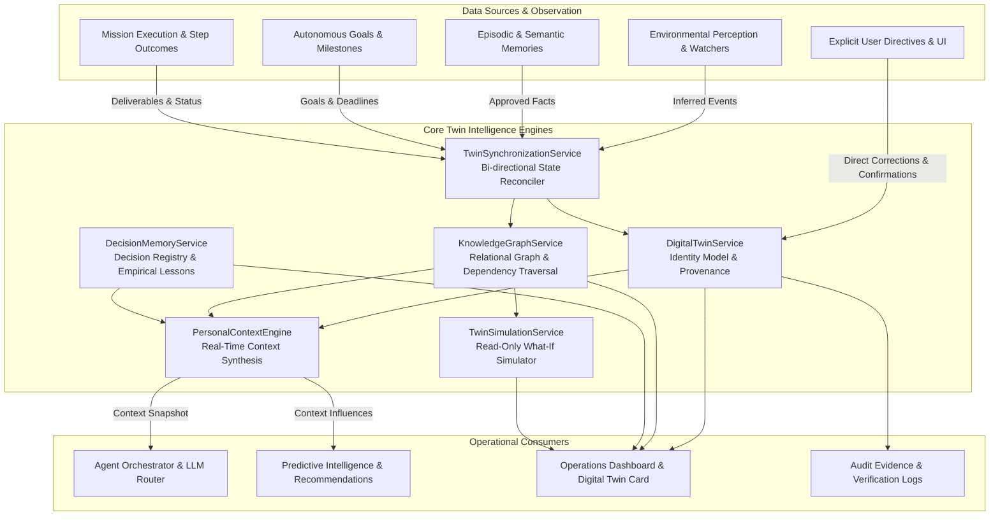

# JARVIS OS 2.0 — PHASE 10: PERSONAL DIGITAL TWIN ARCHITECTURE REPORT

## Executive Summary
Phase 10 elevates JARVIS from an isolated episodic memory system into a persistent, explainable, connected **Personal Digital Twin**. The system models the user's goals, preferences, active projects, routines, decisions, capabilities, and digital operational environment.

Unlike primitive chatbot memory buffers, JARVIS OS 2.0's Digital Twin operates as a structured, relational, and auditable intelligence layer governed by non-negotiable security invariants, strict provenance tracking, and explicit confirmation protocols.

---

## 1. System Topology & Architectural Layers

---

## 2. Core Subsystems

### P0 — Extended Digital Identity Model (`digitalTwinService.js`)
- **Entities Covered:** Preferences, skills, long-term objectives, short-term goals, constraints, interests, active projects, recurring routines, and architectural priorities.
- **Fact Schema:** Every fact records `id`, `category`, `title`, `content`, `priority`, `source`, `confidence` ($0.0 - 1.0$), `is_confirmed` ($0/1$), `last_confirmed_at`, `expiration_policy` (`permanent`, `review_30d`, `review_90d`, `expires_at`), `expires_at`, `review_before`, `user_correction_history`, and `status`.
- **Inference vs. Confirmation Invariant:** Inferred facts (from logs or perception) receive a maximum confidence of $0.70$ and strictly default to `is_confirmed = false`. Only explicit human action (`confirmFact` or direct setting) can promote a fact to `is_confirmed = true` ($1.0$ confidence).
- **User Correction Provenance:** When a user corrects an existing entry, the previous state, timestamp, and explanation are immutably archived into `user_correction_history`.

### P1 — Personal Knowledge Graph (`knowledgeGraphService.js`)
- **Relationship Schema:** Supports typed, weighted directed edges including `GOAL_SUPPORTS_GOAL`, `PROJECT_CONTRIBUTES_TO_GOAL`, `TASK_BELONGS_TO_PROJECT`, `SKILL_REQUIRED_FOR_PROJECT`, `ROUTINE_SUPPORTS_GOAL`, `DECISION_AFFECTS_PROJECT`, `RESOURCE_REQUIRED_BY_TASK`, and `DEPENDS_ON`.
- **Multi-Hop Traversal:** BFS pathfinding up to $N$ hops with cycle detection and confidence pruning (`findPath`).
- **Downstream Impact Analysis:** Recursively traces all goals, projects, and tasks affected if an entity changes or fails (`getDownstreamImpact`).
- **Semantic Contradiction & Dependency Auditing:** Detects opposing relationship types between entities and flags missing or unavailable prerequisites (`detectMissingDependencies`, `detectGraphContradictions`).

### P2 — Contextual State Engine (`personalContextEngine.js`)
Synthesizes 9 operational context dimensions into a single unified context snapshot without exposing raw private memories:
1. Active projects & priorities
2. Important pending goals
3. Live mission commitments
4. Approaching deadlines ($< 48$ hours)
5. Hardware & software resources (CPU, RAM, Disk)
6. Relevant user preferences (with privacy filtering)
7. Active execution blockers (approval gates & stalls)
8. Recent significant decisions & outcomes
9. Natural language contextual explanation

### P3 — Decision Memory Service (`decisionMemoryService.js`)
- Captures context-at-decision, alternatives considered, selected choice, rationale, expected outcome, and impact rating.
- Follow-up recording of empirical actual outcome and lessons learned.
- Indexed via SQLite for semantic search to inform future architectural recommendations without repeating historical errors.

### P4 — Digital Twin Simulation Service (`twinSimulationService.js`)
- **Strict Read-Only Guarantee:** Evaluates hypothetical scenarios without modifying production missions, goals, or twin profiles.
- **Scenarios Evaluated:**
  - Deadline shifts (accelerations or delays)
  - Tool and hardware resource unavailability
  - Timeline contention and delivery collisions ($< 18$ hour delta)
  - Postponing active commitments

### P5 — Contextual Decision Intelligence (`predictiveRecommendationService.js`)
- Links Phase 9 predictive recommendations to the twin context snapshot.
- Recommendations cite contextual influences (e.g. active goals, constraints, confirmed user preferences).

### P6 — Twin Synchronization Service (`twinSynchronizationService.js`)
- Runs periodic reconciliation cycles across memories, goals, missions, and environmental logs.
- Detects stale information and mutually conflicting entries.
- Reconciles twin profiles and knowledge graph entities when real projects complete or change status.

---

## 3. Database Schema Migrations & Storage Architecture

| Table Name | Primary Purpose | Key Fields |
|---|---|---|
| `digital_twin_profiles` | Core user identity & facts | `id`, `category`, `title`, `content`, `confidence`, `is_confirmed`, `last_confirmed_at`, `expiration_policy`, `expires_at`, `user_correction_history`, `status` |
| `graph_entities` | Knowledge graph nodes | `id`, `name`, `entity_type`, `properties`, `confidence`, `source_type` |
| `graph_relationships` | Directed relational edges | `id`, `source_entity_id`, `target_entity_id`, `relationship_type`, `confidence`, `is_inferred`, `weight` |
| `decision_records` | Contextual decision history | `id`, `decision_title`, `context_at_decision`, `alternatives_considered`, `selected_option`, `reasoning_summary`, `actual_outcome`, `lessons_learned` |
| `twin_simulations` | Read-only simulation logs | `id`, `scenario_type`, `parameters`, `simulated_outcomes`, `conflicts_detected`, `recommendations`, `created_at` |

---

## 4. Invariants and Safety Guarantees
1. **Zero Silent Confirmation:** Inferred facts never self-confirm without human approval.
2. **Zero Simulation Mutation:** Simulation runs write exclusively to `twin_simulations` and never touch production state.
3. **Privacy Boundary Enforcement:** Metadata with `is_private: true` is strictly filtered out of general prompt contexts.
4. **Complete Provenance:** Every fact retains source, creation timestamp, and full correction history.
