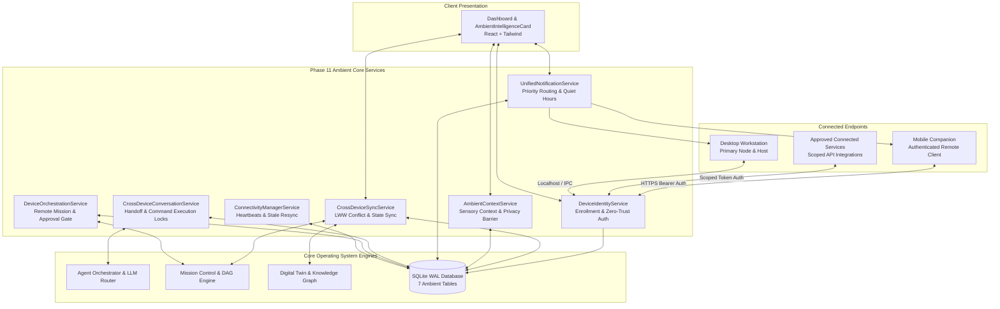

# JARVIS OS 2.0 — PHASE 11: AMBIENT PERSONAL INTELLIGENCE ARCHITECTURE REPORT

## Executive Summary
Phase 11 transforms JARVIS OS 2.0 from a single-node desktop daemon into a secure, cross-device **Ambient Personal Operating System**. The platform maintains unbroken operational continuity, mission progress, conversational context, and situational awareness across desktop workstations, mobile companions, and authorized peripheral services without compromising security or human sovereignty.

Governed by a strict zero-trust model, ambient awareness never assumes trust based on network topology. Peripheral observations, cross-device handoffs, remote approvals, and synchronization events are validated through cryptographic tokens, monotonic sequence checks, versioned Last-Write-Wins conflict resolution, and strict sensory privacy barriers.

---

## 1. System Topology & Architectural Layers

---

## 2. Core Subsystem Architecture

### P0 — Unified Device Identity (`DeviceIdentityService`)
- **Zero-Trust Network Principle:** Devices residing on the same LAN/Wi-Fi subnet are strictly treated as untrusted until cryptographically paired. Physical or network locality confers zero authorization.
- **Cryptographic Enrollment Protocol:**
  - One-time enrollment codes (32-character hex) generated with 5-minute time-to-live (`ttlSeconds: 300`).
  - Upon pairing, a unique device identity (`dev-mobile-xxx`, `dev-desktop-xxx`, `dev-service-xxx`) and high-entropy secret token (`jarvis_dtk_xxx`) are issued.
  - The secret token is hashed via SHA-256 (`credential_hash`) and stored in `trusted_devices`. Plaintext tokens are never stored in the database.
- **Revocation & Credential Rotation:**
  - Revoking a device sets its status to `REVOKED`, wipes its credentials, and terminates all active sessions instantaneously.
  - Periodic token rotation invalidates preceding credentials while preserving device identity and permission scopes.

### P1 — Cross-Device Context Synchronization (`CrossDeviceSyncService`)
- **Monotonic Sync Sequence:** Every mutating operation increments a global monotonic `sync_sequence` integer, enabling incremental differential pulls (`/api/ambient/sync/pull?since_sequence=N`).
- **Entity Synchronization Scope:**
  - Active missions, milestones, and step statuses.
  - Digital Twin confirmed and unconfirmed facts.
  - User goals and task states.
  - System notifications and pending approval gates.
- **Conflict Resolution (Versioned Last-Write-Wins):**
  - Conflicting edits comparing server state vs. client payload evaluate entity `version` and update timestamps.
  - When version divergence is detected, the server's canonical state is preserved (`SERVER_PRESERVED`) and returned as a conflict payload, preventing silent overwrite of desktop state.
- **Idempotent Offline Operation Queue:**
  - Operations accumulated on disconnected companions are stored in `offline_operation_queue` with client-provided UUID `idempotency_key`.
  - Re-queuing or re-draining duplicate operations is discarded as idempotent, preventing duplicated actions or redundant status transitions.

### P2 — Ambient Context Awareness (`AmbientContextService`)
- **Sensory Invariants & Privacy Barrier:**
  - Microphone, camera, and screen observation states default to disabled (`false`) unless explicitly authorized by the user.
  - Strict privacy check (`checkPermission`) runs before any sensory capture or command lock acquisition.
  - Camera access requests trigger explicit human permission requirements; automatic bypass is forbidden.
- **Context Telemetry Dimensions:**
  - Current foreground application, host power status (battery/plugged), network connectivity (ONLINE/OFFLINE), active mission reference, and activity state (`IDLE`, `ACTIVE_WORKING`, `COMMUTING`, `AWAY`).

### P3 — Unified Notification Intelligence (`UnifiedNotificationService`)
- **Priority Tiering:** `CRITICAL`, `HIGH`, `MEDIUM`, `LOW`.
- **Deduplication Window:** Computes a SHA-256 signature hash of `type:title:message`. Identical notifications dispatched within a 10-minute window are suppressed with `DUPLICATE_SUPPRESSED`.
- **Quiet Hours Scheduling:**
  - Configurable start and end hours stored in `settings`.
  - Non-critical alerts (`LOW`, `MEDIUM`, `HIGH`) are held with `QUIET_HOURS_ACTIVE`.
  - `CRITICAL` alerts and `APPROVAL_REQUEST` notifications strictly bypass quiet hours to preserve active mission safety and human gate access.
- **Delivery Acknowledgments (ACK):**
  - Devices submit acknowledgment upon rendering/reading alerts, updating `is_acknowledged = 1` and `acknowledged_by = device_id`.

### P4 — Voice and Conversation Continuity (`CrossDeviceConversationService`)
- **Cross-Device Handoff Protocol:**
  - Active conversational sessions transition across endpoints via cryptographically signed `handoff_id`.
  - Chat history and contextual variables are transferred atomically, marking previous session states as `TRANSFERRED`.
- **Command Execution Locks (Anti-Dual Wake Word):**
  - When multiple listening devices hear the wake word or command (e.g. desktop and phone on the same desk), both attempt to claim an execution lock.
  - The first device to acquire the lock (`command_hash` SHA-256) obtains a valid lock with an 8-second expiration; secondary attempts receive `DUPLICATE_LOCKED` and are suppressed.
  - If the listening device's microphone is muted in `ambient_context_state`, lock acquisition is blocked with `MICROPHONE_MUTED`.
- **Interrupted Voice Recovery:**
  - Handoffs that freeze or disconnect expire automatically after a 5-minute TTL, avoiding zombie locks.

### P5 — Device Orchestration (`DeviceOrchestrationService`)
- **Remote Mission Dispatch:**
  - Authorized companion devices can trigger missions on the desktop host via `/api/ambient/orchestration/dispatch`.
  - Untrusted or revoked devices are immediately rejected.
- **Remote Approval Delegation & Human Gates:**
  - Sensitive mission steps requiring human authorization (`requires_approval = 1`) dispatch an `APPROVAL_REQUEST` notification to paired companions.
  - Mobile companions submit decisions (`approved` / `rejected`).
  - Decisions from unauthorized devices or devices lacking `approve_step` permission are rejected with `INSUFFICIENT_PERMISSIONS`.
  - Requests older than 30 minutes are rejected as `APPROVAL_EXPIRED`.

### P6 — Offline and Recovery Intelligence (`ConnectivityManagerService`)
- **Heartbeat & Status Machine:**
  - Devices send periodic heartbeats (`/api/ambient/devices/:id/heartbeat`).
  - A background connectivity scanner marks devices exceeding 30 seconds of silence as `OFFLINE`.
  - Subsequent heartbeats restore connectivity to `ONLINE` and trigger queued offline operation draining.
- **Stale Device Full Resynchronization:**
  - If a device reconnects after >24 hours of disconnection, incremental delta synchronization is aborted, and a full canonical snapshot resync is mandated.

---

## 3. Database Schema Architecture

Seven dedicated tables support ambient intelligence without modifying core mission tables:

1. `trusted_devices`: Stores device registry, hashed credentials, permissions, and connectivity status.
2. `device_enrollment_tokens`: Manages single-use, time-limited pairing codes.
3. `device_sync_checkpoints`: Tracks per-device sequence numbers and last synchronized timestamps.
4. `offline_operation_queue`: Holds buffered mutations from disconnected companions with idempotency keys.
5. `ambient_context_state`: Tracks sensory states, hardware telemetry, and privacy permissions.
6. `unified_notifications`: Stores priority-ranked notifications, signature hashes, ACKs, and expiration TTLs.
7. `cross_device_handoffs`: Orchestrates conversational context transfers and voice continuity.

---

## 4. Architectural Invariants Summary

| Invariant | Enforcement Mechanism | Failure Defense |
|:---|:---|:---|
| **Zero Network Trust** | Cryptographic token exchange & SHA-256 credential hashing | IP spoofing confers zero rights |
| **No Dual Execution** | 8-second SHA-256 command execution mutex lock | Secondary devices suppressed |
| **Sensory Privacy Barrier** | `AmbientContextService.checkPermission` gate | Hard block on unapproved mic/screen/camera |
| **Human Gate Safety** | Role permission check + 30-minute expiration TTL | Unapproved tools cannot run |
| **Sync Determinism** | Monotonic sequence + versioned Last-Write-Wins | Conflicting edits preserved on server |
| **Unconfirmed Twin Invariance** | Remote twin updates tagged `is_confirmed = 0` | Inferred remote facts cannot alter ground truth |
