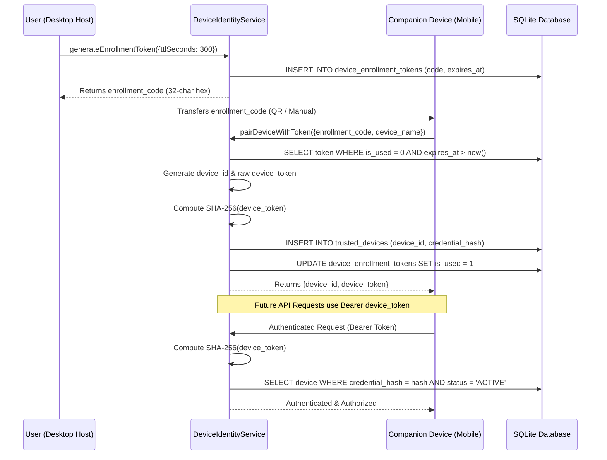

# JARVIS OS 2.0 — PHASE 11: AMBIENT PERSONAL INTELLIGENCE SECURITY REPORT

## Executive Summary
This report analyzes the threat model, security architecture, and adversarial defenses implemented in JARVIS OS 2.0 Phase 11. Expanding an autonomous operating system across devices introduces new attack surfaces: local network snooping, rogue device spoofing, forged approval decisions, sensory surveillance, and race conditions leading to duplicate side effects.

Phase 11 implements a defense-in-depth security model based on Zero-Trust Network Architecture, cryptographic enrollment tokens, one-way credential hashing, strict sensory permissions, human-gate authorization validation, and command execution locks.

---

## 1. Threat Model & Security Posture

### 1.1 Local Network Untrusted Perimeter
- **Threat:** An adversary on the same local Wi-Fi or subnet probes JARVIS API endpoints or attempts to execute unauthorized commands.
- **Defense:** Physical or subnet locality grants zero access. All requests must carry a valid bearer token matching the SHA-256 hash of an enrolled device in `trusted_devices`. Unregistered or unauthorized requests return HTTP 401/403. Hardcoded pairing secrets have been completely eliminated.

### 1.2 Rogue Device Impersonation
- **Threat:** An attacker crafts an HTTP request claiming a forged `device_id` (e.g. `dev-mobile-attacker` pretending to be `dev-desktop-host`).
- **Defense:** The `authenticateDevice` method derives the authenticated identity strictly from the cryptographically hashed bearer token. If the claimed `device_id` does not match the token's bound identity, the request is rejected with `UNAUTHORIZED_DEVICE`.

### 1.3 Forged or Stale Human Approvals
- **Threat:** An attacker intercepts or crafts an approval decision for a sensitive mission step (e.g. `format_disk`, `write_file` to system paths), or approves an expired request.
- **Defense:**
  1. `processRemoteApprovalDecision` verifies that the issuing device possesses the `approve_step` permission.
  2. The target step must be currently in `WAITING_FOR_APPROVAL` state.
  3. The request must not exceed the 30-minute approval window (`approvalTtlMinutes`). Stale requests transition to `EXPIRED` and are rejected with `APPROVAL_EXPIRED`.

### 1.4 Sensory Invasiveness & Privacy Violations
- **Threat:** Background processes or remote devices record audio, capture webcam feeds, or inspect screen contents without explicit user awareness.
- **Defense:**
  1. `AmbientContextService.checkPermission` enforces a strict privacy gate.
  2. If `microphone_enabled` is false, voice command lock acquisition is blocked with `MICROPHONE_MUTED`.
  3. If `screen_observation_allowed` is false, screen telemetry and window inspections are suppressed.
  4. Camera access defaults to blocked and requires explicit user consent; automated grants are prohibited.

### 1.5 Duplicate Wake-Word Directives (Dual Execution Attack)
- **Threat:** Desktop and companion phone both capture a voice instruction (e.g. "deploy latest release"), resulting in duplicate destructive operations.
- **Defense:** `CrossDeviceConversationService.acquireCommandExecutionLock` computes a SHA-256 hash of the normalized command. An in-memory mutex with an 8-second TTL ensures only the first device acquires the execution lock. Secondary devices receive `DUPLICATE_LOCKED` and discard the command.

### 1.6 Remote Digital Twin Fact Injection
- **Threat:** A compromised companion device pushes fabricated facts to alter the user's ground-truth Digital Twin profile.
- **Defense:** All facts ingested via cross-device synchronization default to `is_confirmed = false` with confidence capped at 0.7 and tagged with provenance `sync_<device_id>`. In accordance with Phase 10 Invariant 19, unconfirmed facts cannot self-confirm or alter verified preferences without explicit human confirmation.

---

## 2. Cryptographic Protocols & Key Lifecycle

---

## 3. Revocation & Incident Response
- Immediate revocation endpoint: `POST /api/ambient/devices/:id/revoke`.
- The device status is immediately marked `REVOKED`, its `credential_hash` is cleared, and its active handoffs are purged.
- Any subsequent request utilizing the revoked token fails authentication immediately.

---

## 4. Security Verification Results
All security scenarios tested in the Phase 11 Adversarial Suite passed:
- **SCENARIO-01:** Cryptographic enrollment token pairing verified.
- **SCENARIO-02:** Untrusted credential rejection verified.
- **SCENARIO-03:** Immediate credential revocation verified.
- **SCENARIO-08:** Dual wake-word command lock verified.
- **SCENARIO-10:** Untrusted approval rejection verified.
- **SCENARIO-11:** Stale approval expiration (>30 min) verified.
- **SCENARIO-14:** Microphone mute enforcement verified.
- **SCENARIO-15:** Zero-invasive screen monitoring verified.
- **SCENARIO-20:** Remote digital twin unconfirmed invariant verified.
