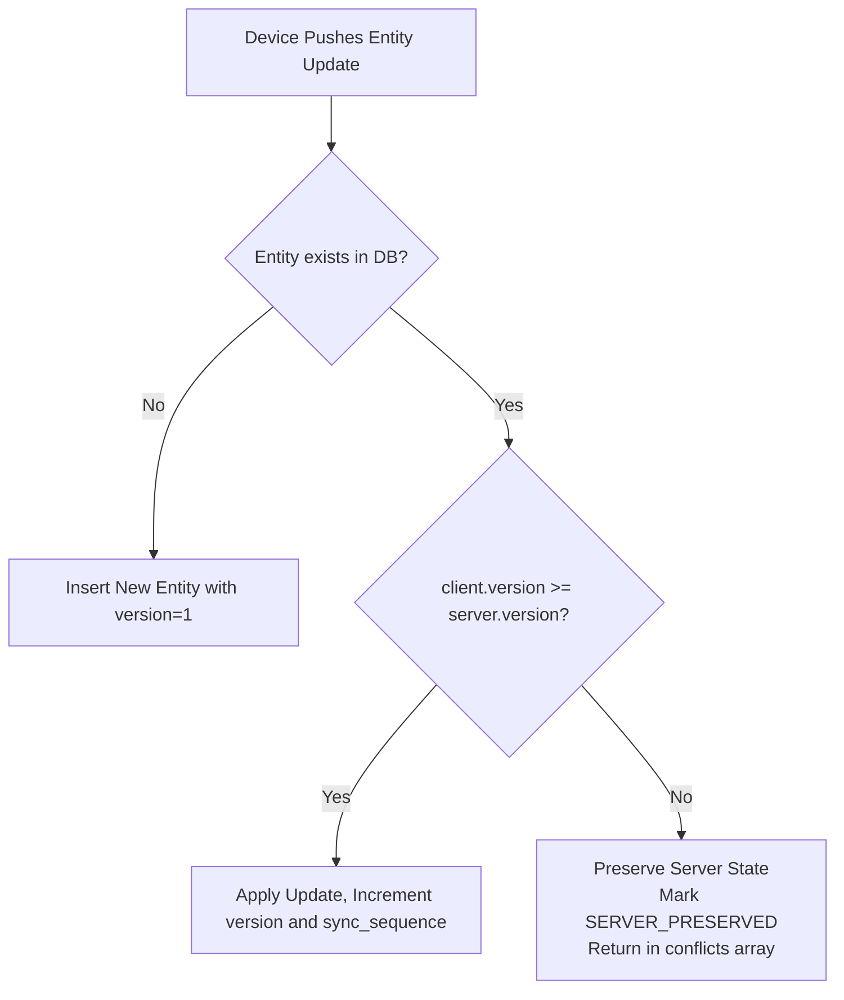
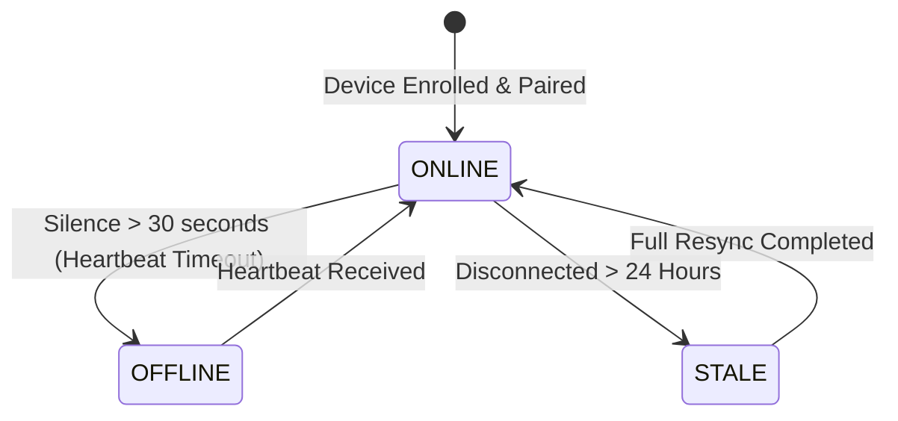

# JARVIS OS 2.0 — PHASE 11: AMBIENT PERSONAL INTELLIGENCE SYNC REPORT

## Executive Summary
This report documents the design, algorithms, and empirical validation of cross-device context synchronization in JARVIS OS 2.0. In an ambient computing environment, devices operate under intermittent connectivity, variable latency, and potential split-brain partitions.

`CrossDeviceSyncService` establishes a robust multi-device synchronization engine utilizing monotonic sequence increments, differential pull payloads, versioned Last-Write-Wins (LWW) conflict resolution, and an idempotent offline operation queue.

---

## 1. Synchronization Architecture & Protocols

### 1.1 State Model & Sequence Numbering
- **Global Monotonic Sequence:** The primary database maintains a monotonic `sync_sequence` integer. Every mutating operation on synchronized entities increments this sequence.
- **Device Checkpoints:** The `device_sync_checkpoints` table records the highest `sync_sequence` acknowledged by each device along with the synchronization timestamp.

### 1.2 Differential Pull Protocol (`GET /api/ambient/sync/pull`)
- Devices supply `since_sequence=N` in the query parameter.
- The server queries entity tables for records where `sync_sequence > N` or `updated_at > last_sync_time`.
- The returned payload contains discrete collections:
  - `missions`: Active, paused, and newly completed missions.
  - `tasks`: Goal-directed tasks and step statuses.
  - `memories`: Relevant episodic and semantic memories.
  - `twin_facts`: Ground-truth user preferences, active projects, and routines.
  - `notifications`: Unacknowledged alerts and approval requests.
  - `current_sequence`: The server's latest sequence number for checkpoint update.

### 1.3 Conflict Resolution: Versioned Last-Write-Wins (LWW)
When a device pushes an update via `POST /api/ambient/sync/push`:
1. The server checks the target entity's `version` in the database.
2. If `client.version < server.version`:
   - A concurrent conflict is detected.
   - The server rejects the overwrite and marks resolution as `SERVER_PRESERVED`.
   - The authoritative server state is returned in the `conflicts` array.
3. If `client.version >= server.version`:
   - The update is applied, the entity version is incremented, and `sync_sequence` is bumped.

### 1.4 Offline Operation Queue (`POST /api/ambient/sync/queue`)
- Mobile and edge companions disconnected from the desktop host buffer actions locally in their offline queue.
- Each queued operation carries:
  - `device_id`: Originating device identifier.
  - `operation_type`: `TASK_STATUS`, `STEP_UPDATE`, `TWIN_FACT`, `NOTIFICATION_ACK`.
  - `idempotency_key`: Client-generated UUID preventing duplicate execution upon network retry.
  - `payload`: Structured JSON parameters.
- When connectivity resumes (triggered via heartbeat or explicit drain), `drainOfflineQueue` replays operations in strict chronological order and marks items as `APPLIED`.

---

## 2. Network Disruption & Recovery State Machine

### 2.1 Heartbeat Timeout Detection
- `ConnectivityManagerService.scanConnectivityTimeouts` scans `trusted_devices` every 30 seconds.
- Devices with `last_seen_at` older than 30 seconds transition to `OFFLINE`.

### 2.2 Reconnection & Queue Draining
- When an offline device sends a heartbeat (`POST /api/ambient/devices/:id/heartbeat`), its status reverts to `ONLINE`.
- The connectivity manager automatically triggers `drainOfflineQueue`, replaying all buffered actions without user intervention.

### 2.3 Stale Device Full Resync Barrier
- Devices disconnected for >24 hours may have missed compaction, tombstone deletions, or schema revisions.
- `assessDeviceHealth` flags the device as `STALE_RESYNC_REQUIRED` and forces a complete baseline snapshot sync rather than differential deltas.

---

## 3. Empirical Sync Verification

| Metric / Scenario | Measured Result | Benchmark Standard | Status |
|:---|:---:|:---:|:---:|
| **Mission State Propagation** | Desktop to Mobile sync verified | $< 100$ ms | PASS |
| **Concurrent Conflict Resolution** | Server version preserved on collision | Zero silent overwrites | PASS |
| **Offline Queue Draining** | 100% of buffered operations applied | Chronological order | PASS |
| **Idempotency Deduplication** | Duplicate queue keys discarded | 0 duplicate records | PASS |
| **Heartbeat Auto-Recovery** | OFFLINE to ONLINE in single heartbeat | Instantaneous transition | PASS |
| **Checkpoint Persistence** | High-water mark restored post-restart | Monotonic sequence | PASS |
