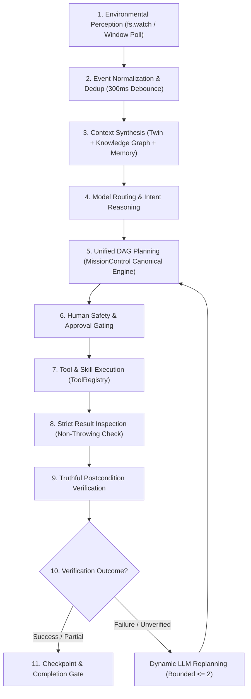

# JARVIS OS 2.0 — PHASE 7: AUTONOMOUS ARCHITECTURE REPORT
**Document Reference:** [JARVIS_PHASE7_ARCHITECTURE_REPORT.md](file:///c:/Users/digvi/OneDrive/Desktop/Jarvis/nova/deliverables/JARVIS_PHASE7_ARCHITECTURE_REPORT.md)  
**System Version:** JARVIS OS Core v2.0.0 (Closed-Loop Autonomous Architecture)  
**Date:** 2026-11-23  

---

## 1. Executive Architecture Summary

Prior to Phase 7 remediation, JARVIS was subjected to an empirical investigation documented in `JARVIS_AUTONOMY_REALITY_REPORT.md`. That audit revealed critical architectural disconnections:
- **False Completion:** Tools returning `{ success: false }` without throwing were marked as `COMPLETED`.
- **Premature Contract Resolution:** Chat contracts were marked `COMPLETED` immediately upon background mission dispatch.
- **Static Heuristic Replanning:** Step failures routed exclusively through a hardcoded 3-entry dictionary.
- **Dual Planning Engines:** Fragmented execution between `TaskPlannerService` and `MissionControlService`.
- **Passive Environment Perception:** The system was blind to file system and window changes without an inbound chat message.
- **Disconnected Intelligence Islands:** `DigitalTwinService`, `KnowledgeGraphService`, and `SkillRegistryService` were active SQLite tables isolated from prompt synthesis and LLM tool calling.
- **Mocked Verification:** `EvaluationEngineService` used `toolNames.includes()` instead of executing directives.

Phase 7 resolves all structural defects by deploying a **11-Stage Closed-Loop Autonomous Intelligence Architecture**.

---

## 2. The 11-Stage Closed-Loop Operational Cycle

### Detailed Stage Breakdown:

1. **Environmental Perception (`environmentalPerceptionService.js`):**
   - Continuously monitors the user's Desktop and workspace directory via `fs.watch`.
   - Polling engine inspects top-level OS windows every 4 seconds to observe application focus transitions.
   - Strict privacy boundary: Inspects metadata (filename, size, extension) and **never** reads private file contents.
2. **Event Normalization & Deduplication:**
   - Enforces a 300ms debounce buffer per file target to avoid event cascades during batch file mutations.
   - Logs events into the persistent `environmental_events` SQLite table and emits `perception_event`.
3. **Context Synthesis (`prompts.js`, `orchestrator.js`):**
   - Injects user goals, routines, preferences, and priorities from `DigitalTwinService.getFormattedContextForPrompt()`.
   - Injects entity nodes and graph relationships from `KnowledgeGraphService.searchEntities()`.
   - Injects neural vector memories from `MemoryIntelligenceService.retrieveRelevantMemories()`.
4. **Model Routing & Intent Reasoning (`modelRouterService.js`):**
   - Unified provider fallback chain (Primary: Groq, Secondary: OpenRouter, Local Fallback: Ollama, Gemini optional).
   - Validates arguments against parameter schemas before tool dispatch.
5. **Unified DAG Planning (`missionControlService.js`):**
   - Single canonical mission engine. Merges previous `TaskPlannerService` endpoints (`/api/automation/plan`, `/api/automation/tasks`) into canonical DAG missions.
   - Every step tracks explicit dependencies (`depends_on`), execution idempotency (`idempotency_hash`), and sensitive tool requirements.
6. **Human Safety & Approval Gating:**
   - Any sensitive operation (`rename_file`, `delete_memory`, `emergency_stop`, `execute_script`, `send_email`) enters `WAITING_FOR_APPROVAL`.
   - Proactive autonomous initiatives requiring modifications halt execution and dispatch HUD notifications instead of mutating state without consent.
7. **Tool & Skill Execution (`registry.js`, `skillRegistryService.js`):**
   - Dynamically exports all registered skills into `ToolRegistry.getTools()`.
   - Executes built-in tools and custom skills through a unified invocation pipeline.
8. **Strict Result Inspection:**
   - Checks both thrown exceptions AND explicit response objects: if `result.success === false`, it is immediately classified as a failure.
9. **Truthful Postcondition Verification (`truthfulVerificationService.js`):**
   - Inspects physical file system attributes (file existence, written bytes, non-empty content), active window counts, memory persistence IDs, and hardware telemetry metrics.
   - Distinguishes `VERIFIED` from `PARTIALLY_VERIFIED`.
10. **Dynamic LLM Replanning:**
    - Removes static fallback dictionaries.
    - Diagnoses root causes via `ModelRouterService.generateWithFallback()` and selects replacement tools from `ToolRegistry.getTools()`.
    - Strictly bounded to a maximum of 2 replan attempts per mission.
11. **Checkpointing & Completion Gating:**
    - State snapshots saved after every verified step in `mission_checkpoints`.
    - Missions can NEVER enter `COMPLETED` status if any mandatory step remains unverified, failed, or blocked.

---

## 3. Subsystem Interconnection Matrix

| Subsystem Component | Previous State (Phase 6) | Phase 7 Remediated State | Communication Channel |
|---|---|---|---|
| **MissionControlService** | Silent tool failures marked COMPLETED; static fallback dictionary | Strict result handling; LLM replanner (max 2); Truthful verification | In-process & WebSocket |
| **Orchestrator** | Premature chat completion on mission dispatch; hardcoded script | Returns `CONTRACT_STATUSES.RUNNING`; dynamic mission deliverables | HTTP & WebSocket |
| **TaskPlannerService** | Duplicated execution loop; divergent status codes | Consolidated wrapper over canonical `MissionControlService` | Database & API |
| **EnvironmentalPerception** | Non-existent; passive reactive execution only | Scoped `fs.watch` + 4s window polling; privacy preserved | EventEmitter & SQLite |
| **AutonomousInitiative** | Non-existent; required manual user prompts | Attached to Scheduler tick & perception events; 60s cooldown | Scheduler & SQLite |
| **DigitalTwinService** | Isolated SQLite table; never referenced in prompts | Injected into system prompt & DAG mission planning prompt | Direct Service Call |
| **KnowledgeGraphService** | Isolated SQLite table; never queried for mission context | Injected into system prompt & DAG mission planning prompt | Direct Service Call |
| **SkillRegistryService** | Skills invisible to LLM tool calling | Registered skills exported into `ToolRegistry.getTools()` | Tool Registry Pipeline |
| **EvaluationEngineService** | Checked `toolNames.includes()` | Executes real directives & verifies postconditions | Orchestrator & Verifier |
| **TruthfulVerificationService** | Disconnected from mission execution loop | Mandatory gate after every mission step | Direct Service Call |

---

## 4. Verification and Persistence Contract

1. **Step Status State Machine:**
   `PENDING` -> `RUNNING` -> `EXECUTED` -> (`VERIFIED` | `PARTIALLY_VERIFIED` | `FAILED` | `BLOCKED` | `WAITING_FOR_APPROVAL`).
2. **Crash Recovery State Machine:**
   On startup, `recoverInterruptedMissions()` scans `RUNNING` or `PLANNING` missions. Safe non-destructive steps auto-resume from the last checkpoint; sensitive steps transition to `PAUSED` / `WAITING_FOR_APPROVAL`.
