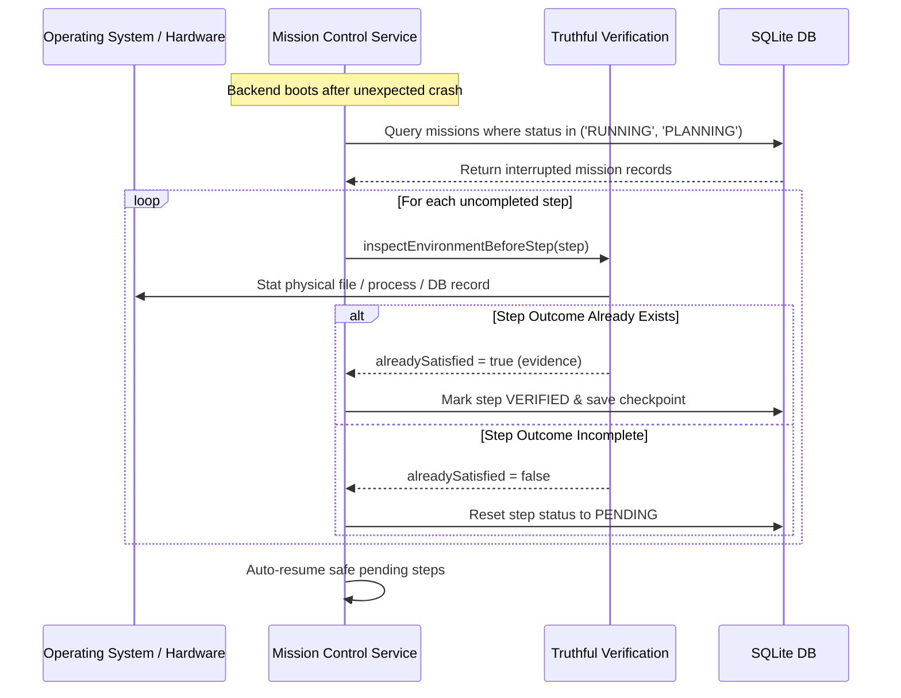

# JARVIS OS 2.0 — PHASE 8: AUTONOMOUS FIELD OPERATIONS ARCHITECTURE REPORT

## Executive Summary

Phase 8 elevates JARVIS from a verified, closed-loop agentic framework (established in Phase 7) into a **persistent, goal-driven autonomous personal AI operating system**. JARVIS operates independently of the frontend lifecycle, continuously observes its environmental operational context, reacts to system-level events, executes multi-step Directed Acyclic Graph (DAG) missions, tolerates software and hardware crashes, and truthfully validates real physical state before confirming goal attainment.

Every architectural modification has been integrated directly into the canonical backend architecture without introducing duplicate orchestrators or mock execution layers.

---

## 1. Core Architectural Tenets

```mermaid
flowchart TD
    Env["Real Windows Environment (Files, Windows, Processes)"] -->|Event Streams| P1["Environmental Perception Engine"]
    P1 -->|Noise Filter| P1_Classify{"Relevance & Noise Filter"}
    P1_Classify -->|Noise Ignored| Ignored["Suppressed Noise (temp/swap/crdownload)"]
    P1_Classify -->|Correlated| RelLog["Event Relevance Logs (DB)"]
    RelLog -->|Contextual Signal| GoalMgmt["Goal Management & Stall Monitor"]
    
    User["User Directive / Proactive Initiative"] --> GoalMgmt
    GoalMgmt -->|Active Objective| P0["Mission Control DAG Engine"]
    
    P0 -->|Durable Checkpoints| DB[(SQLite State Store)]
    P0 -->|Pre-State Inspection| P4_Pre["Environmental Pre-State Capture"]
    P4_Pre -->|If Already Satisfied| P4_Verify["Skip Redundant Execution (Idempotent)"]
    P4_Pre -->|If Unexecuted| ToolReg["Tool Registry Execution"]
    
    ToolReg -->|Raw Subsystem Result| P4_Post["Environmental Post-State Capture"]
    P4_Post --> P4_Verify["Truthful Verification Service"]
    
    P4_Verify -->|Verified| Deliverable["Deliverable Catalog & Checkpoint"]
    P4_Verify -->|Failure / Unverified| P2["Dynamic DAG Replanner & Compensation"]
    P2 -->|Alternative Tool (Max 2 Replans)| P0
    P2 -->|Unrecoverable| Escalation["Compensation Action & Escalation Broadcast"]
```

---

## 2. Priority Subsystems Architecture

### P0 — Persistent Mission Runtime

1. **Frontend-Independent Lifecycle:**
   - The mission execution loop runs as an asynchronous background worker in the Node.js core process.
   - Disconnecting the browser, closing the HUD UI, or terminating the WebSocket client does not interrupt or abort active missions.

2. **Durable Checkpoints & Crash Recovery:**
   - After every verified step, a state snapshot is written to `mission_checkpoints`.
   - On backend boot or post-crash reboot, `MissionControlService.recoverInterruptedMissions()` discovers all missions left in `RUNNING` or `PLANNING` states.

3. **Environmental Pre-State Inspection Before Retry:**
   - Before blindly retrying an interrupted step upon restart, `inspectEnvironmentBeforeStep(step)` inspects the physical OS state:
     - For `write_file`: Checks if the target path exists with `size > 0`.
     - For `create_folder`: Checks directory existence.
     - For `save_memory`: Checks if the key exists in the `memories` table.
     - For `create_task`: Checks if the task title exists in the `tasks` table.
   - If the postcondition is already satisfied, the step is marked `VERIFIED` immediately, avoiding redundant operations or corrupted side-effects.

4. **Deterministic Idempotency Hashes:**
   - Every step computes `sha256(tool + JSON.stringify(args))`. Steps with matching idempotency hashes reuse verified outputs within the same mission scope.



---

### P1 — Environmental Intelligence & Relevance Engine

1. **Active Perception Monitors:**
   - `EnvironmentalPerceptionService` monitors user-authorized scopes (`Desktop`, workspace root) up to a hard ceiling of 10 concurrent watchers.
   - Employs zero-inspection policies on unauthorized or private system folders.

2. **Noise Suppression Filter:**
   - Filters temporary artifacts matching `/^(~\$|\.)|(\.(tmp|swp|bak|log|lock|git|crdownload|part)|4913)$/i`.
   - Suppressed artifacts are logged to `event_relevance_logs` with `is_relevant = 0` and category `noise`.

3. **Active Objective Correlation:**
   - When a valid filesystem or window event arrives, `classifyAndFilterEvent(eventData)` correlates target basenames and full paths against:
     - Active mission steps and objectives.
     - Active autonomous goals and success criteria.
   - Correlated events trigger `mission_event_correlated` and notify waiting missions.

---

### P2 — Adaptive Execution & Rollback Recovery

1. **Failure Diagnosis & Classification:**
   - Subsystem failures are classified into deterministic categories:
     - `TRANSIENT_NETWORK`
     - `TIMEOUT`
     - `PERMISSION_DENIED`
     - `INVALID_ARGUMENTS`
     - `RESOURCE_NOT_FOUND`
     - `SYSTEM_FAULT`

2. **Dynamic DAG Replanning:**
   - When a step fails, `replanMissionDAG` diagnoses the failure.
   - It queries available tools from `ToolRegistry` and reformulates the step using an alternative valid tool (e.g., `read_file` -> `search_files`; `conduct_deep_research` -> `search_web`).
   - Replan attempts are bounded to a maximum of 2.

3. **Compensation Actions (Rollback):**
   - Each step supports a `compensation_action` schema.
   - When all retries and replans are exhausted, `executeCompensation(step)` performs cleanup (e.g., deleting orphaned temporary files).
   - Remaining pending steps are marked `BLOCKED`, the mission status is set to `FAILED`, and a `MISSION_ESCALATED` event is broadcast.

---

### P3 — Goal Management & Stall Detection

1. **Persistent `autonomous_goals` Repository:**
   - Persists long-running user objectives with priorities, deadlines, and success criteria.
   - Links high-level goals directly to executing missions (`linked_mission_id`).

2. **Heartbeat Tracking & Stall Detector:**
   - Missions maintain `last_heartbeat` updated on every progress pass.
   - `detectStalledObjectives(thresholdMinutes)` flags missions with zero progress or dependency deadlocks as `stall_status = 'STALLED'`.
   - Stalled items emit `STALL_DETECTED` events and log warnings in `activity_logs`.

3. **Proactive Initiative Recommendations:**
   - `recommendInitiatives(recentEvents)` synthesizes observed environment events into actionable initiatives requiring user consent before dispatch.

---

### P4 — Independent Truthful Verification

1. **Pre/Post State Differentials:**
   - `TruthfulVerificationService.capturePreState()` takes a physical snapshot prior to tool execution.
   - `TruthfulVerificationService.capturePostState()` takes a physical snapshot after execution.
   - Output postconditions are evaluated against the delta (file existence, byte size growth, memory key presence).

2. **Rigorous Four-State Result Modeling:**
   - `VERIFIED`: Postconditions confirmed in real physical environment.
   - `PARTIALLY_VERIFIED`: Operation succeeded with partial output (e.g. truncated file read).
   - `FAILED`: Postcondition not satisfied or tool reported `{ success: false }`.
   - `BLOCKED`: Dependency failed or sensitive step waiting for approval.

---

### P5 — Autonomous Operations Dashboard API

Mounted at `/api/operations`:
- `GET /api/operations/dashboard`: Aggregated telemetry, goals, active missions, verification evidence, and relevance logs.
- `GET /api/operations/goals` / `POST /api/operations/goals` / `PUT /api/operations/goals/:id`: Goal lifecycle management.
- `GET /api/operations/relevance-logs`: Filtered environmental event correlation history.
- `GET /api/operations/stalls`: Stalled missions and blocked dependency diagnostics.
- `POST /api/operations/recommendations`: Proactive initiative generation.

---

## 3. Architecture Invariants Verification Summary

| Invariant | Guarantee | Enforced In |
|---|---|---|
| **Zero Mock Simulation** | Real Windows filesystem, real processes, real SQLite DB | `server.js`, `missionControlService.js` |
| **No False Completion** | No mission marked COMPLETED with unverified steps | `missionControlService.js:1064-1073` |
| **Crash Safety** | Checkpoints saved per step; pre-inspection before retry | `missionControlService.js:160-225` |
| **Security Invariant** | Sensitive tools require human approval | `missionControlService.js:743-755` |
| **Idempotency** | Duplicate action hashes and existing files skipped | `missionControlService.js:930-942` |
| **Noise Immunity** | Temp files, swap files, git locks suppressed | `environmentalPerceptionService.js:216-237` |
| **Bounded Re-planning** | Max 2 replans, max 3 step attempts before escalation | `missionControlService.js:495-500` |
