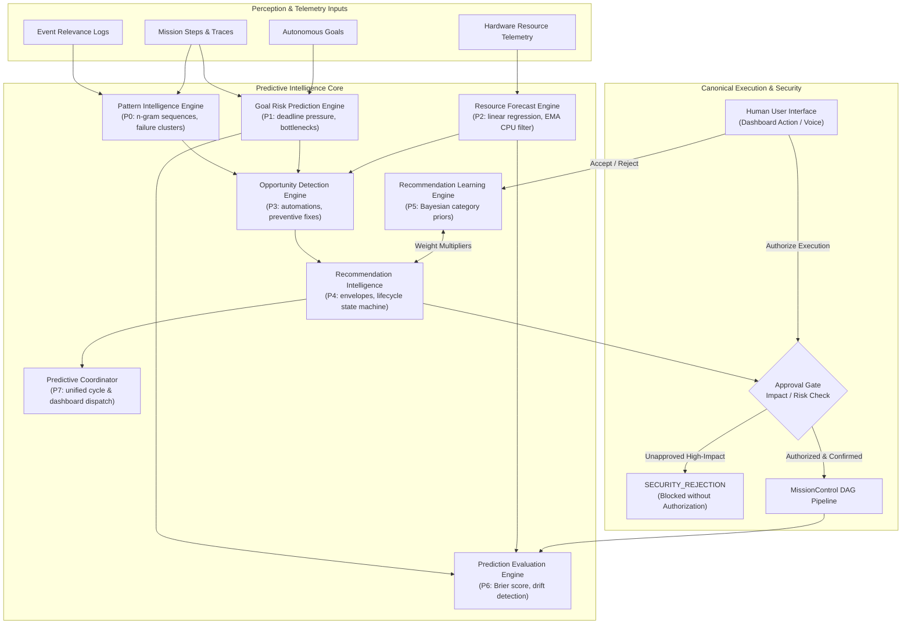

# JARVIS OS 2.0 — PHASE 9: PREDICTIVE INTELLIGENCE ENGINE ARCHITECTURE REPORT

**Document ID:** `JARVIS-PHASE9-ARCH-001`  
**Status:** `VERIFIED & OPERATIONAL`  
**Classification:** `Core Systems Architecture Specification`  
**Associated Deliverables:**
- [JARVIS_PHASE9_IMPLEMENTATION_REPORT.md](file:///c:/Users/digvi/OneDrive/Desktop/Jarvis/nova/deliverables/JARVIS_PHASE9_IMPLEMENTATION_REPORT.md)
- [JARVIS_PHASE9_PREDICTION_EVALUATION.md](file:///c:/Users/digvi/OneDrive/Desktop/Jarvis/nova/deliverables/JARVIS_PHASE9_PREDICTION_EVALUATION.md)
- [JARVIS_PHASE9_ADVERSARIAL_REPORT.md](file:///c:/Users/digvi/OneDrive/Desktop/Jarvis/nova/deliverables/JARVIS_PHASE9_ADVERSARIAL_REPORT.md)
- [phase9_prediction_evidence.json](file:///c:/Users/digvi/OneDrive/Desktop/Jarvis/nova/deliverables/phase9_prediction_evidence.json)

---

## 1. Executive Summary

Phase 9 elevates JARVIS OS 2.0 from an autonomous closed-loop execution engine into a proactive, anticipatory operating system. Rather than solely waiting for directives or reacting to past state changes, JARVIS continuously analyzes operational logs, models hardware trajectories, predicts goal impediment risks, detects unprompted opportunities, issues human-in-the-loop recommendations, and calibrates its probabilistic forecasts using empirical outcome scoring.

### Non-Negotiable Architectural Guarantees
1. **Zero Duplicate Orchestrators:** All actionable recommendations execute exclusively through the canonical `MissionControlService` DAG pipeline and respect existing approval gates.
2. **Strict Probabilistic Restraint:** Predictions are explicitly framed with uncertainty intervals (e.g., $P(\text{delay}) = 0.72 \pm 0.08$) and never asserted as deterministic certainties.
3. **Immutable Pre-Outcome Storage:** Predictions are written to SQLite table `stored_predictions` *before* real-world outcomes occur, preventing retrospective scoring manipulation.
4. **Security Isolation:** Unapproved high-impact actions (file deletions, system modifications, critical processes) are strictly blocked with `SECURITY_REJECTION`. Feedback learning cannot alter security boundaries.

---

## 2. Anticipatory Intelligence System Architecture

---

## 3. Sub-Engine Technical Breakdown

### P0: Pattern Intelligence Engine (`PatternIntelligenceService`)
- **Workflow Sequences ($T_1 \to T_2$):** Computes transition matrices across mission DAGs. An edge is classified as a genuine pattern if and only if $N_{\text{trans}} \ge 3$ and transition probability $P(T_2 \mid T_1) \ge 0.60$. Bayesian confidence scaling: $C = \min\left(0.98, \frac{N}{N+2} \cdot P(T_2 \mid T_1)\right)$.
- **Failure Cluster Mining:** Groups failures by $(tool, error)$. Tools exceeding 3 failures are isolated as chronic risks.
- **Environmental Correlations:** Mines correlations between event triggers (e.g. `FILE_WATCHER_CHANGE`) and affected mission entities.
- **Temporal Rhythms:** Identifies concentrated activity by hour-of-day buckets.

### P1: Predictive Goal Risk Engine (`GoalRiskPredictionService`)
- Evaluates active autonomous goals across 4 weighted risk vectors:
  1. **Deadline Pressure:** Computes hours remaining $H_{\text{rem}}$ vs required workload $H_{\text{req}} = \frac{N_{\text{rem}} \cdot \text{avgStepMin} \cdot 2.5}{60}$. If $H_{\text{rem}} < H_{\text{req}}$, deadline pressure is assessed with heavy weighting ($4.0\times$).
  2. **Dependency Bottlenecks:** Checks linked missions for `BLOCKED` prerequisite steps and `WAITING_FOR_APPROVAL` idle gates.
  3. **Historical Failure Rate:** Categorical baseline velocity failure rate.
  4. **Uncertainty Bounds:** Every goal prediction asserts lower and upper probability bounds ($P \pm 0.08$).

### P2: Resource Trajectory & Exhaustion Engine (`ResourceForecastService`)
- **Linear Regression for Storage Depletion:** Fits $y = \text{slope} \cdot x + \text{intercept}$ over chronological `disk_free_gb` samples. If $\text{slope} < -0.001$, hours to exhaustion is calculated as $\frac{\text{free}}{\lvert\text{slope}\rvert \cdot 6}$.
- **Exponential Moving Average (EMA) for CPU Load:**
  $$\text{EMA}_t = \alpha \cdot \text{CPU}_t + (1 - \alpha) \cdot \text{EMA}_{t-1}, \quad \alpha = \frac{2}{N+1}$$
  Filters instantaneous transient spikes ($>85\%$) while flagging sustained structural load ($\text{EMA} \ge 70\%$).
- **Queue and DB Growth:** Monitors pending task queue velocity and SQLite database page growth rate.

### P3: Opportunity Detection Engine (`OpportunityDetectionService`)
- **Repetitive Workflow Automation:** Identifies recurring manual user actions ($N \ge 3$) and proposes scheduled cron jobs.
- **Unresolved Recurring Problems:** Converts chronic tool failure clusters into preventive repair initiatives.
- **Task Consolidation:** Merges co-occurring read/search operations across missions.

### P4: Recommendation Intelligence Engine (`PredictiveRecommendationService`)
- **Canonical Envelope:** Unique ID (`rec-...`), recommendation type, title, description, triggering evidence, confidence, impact (`LOW`, `MEDIUM`, `HIGH`, `CRITICAL`), time horizon, suggested action, risk classification, and status.
- **State Machine:** `PENDING` $\to$ `ACCEPTED` / `REJECTED` / `EXPIRED` $\to$ `EXECUTED` / `FAILED`.
- **Deduplication:** Hash signature based on `type + title + action_payload` suppresses identical redundant proposals.
- **Approval Barrier:** Recommendations with high impact or sensitive tools strictly require `isExplicitlyApproved = true`.

### P5: Recommendation Learning Engine (`RecommendationLearningService`)
- Category weight multipliers dynamically update based on user decisions:
  - **Acceptance:** Category multiplier boosted ($\times 1.15$).
  - **Rejection:** Category multiplier penalized ($\times 0.80$).
  - **Intervention Success:** Boosted ($\times 1.10$).
  - **Bounded Limits:** Clamped strictly between $0.25$ and $2.0$.
  - **Security Invariance:** Multipliers affect *confidence scoring only* and never loosen approval policies.

### P6: Prediction Evaluation & Calibration Engine (`PredictionEvaluationService`)
- **Pre-Outcome Persistence:** Stored in `stored_predictions` prior to event resolution.
- **Brier Score (Mean Squared Error of Forecasts):**
  $$BS = \frac{1}{N} \sum_{i=1}^N (p_i - o_i)^2, \quad o_i \in \{0, 1\}$$
  Scores $<0.20$ indicate superior calibration.
- **Prediction Drift Detection:** Compares baseline historical accuracy against recent temporal windows. If drop $\ge 0.20$, an automated recalibration alert is emitted.

---

## 4. Architectural Verification Baseline

| Subsystem Component | Service File | Verification Status |
| :--- | :--- | :--- |
| Pattern Mining | [patternIntelligenceService.js](file:///c:/Users/digvi/OneDrive/Desktop/Jarvis/nova/backend/services/patternIntelligenceService.js) | ✅ Verified (5/5 Scenarios) |
| Goal Risk Forecasting | [goalRiskPredictionService.js](file:///c:/Users/digvi/OneDrive/Desktop/Jarvis/nova/backend/services/goalRiskPredictionService.js) | ✅ Verified (4/4 Scenarios) |
| Resource Forecasting | [resourceForecastService.js](file:///c:/Users/digvi/OneDrive/Desktop/Jarvis/nova/backend/services/resourceForecastService.js) | ✅ Verified (3/3 Scenarios) |
| Opportunity Detection | [opportunityDetectionService.js](file:///c:/Users/digvi/OneDrive/Desktop/Jarvis/nova/backend/services/opportunityDetectionService.js) | ✅ Verified (2/2 Scenarios) |
| Recommendation Safety | [predictiveRecommendationService.js](file:///c:/Users/digvi/OneDrive/Desktop/Jarvis/nova/backend/services/predictiveRecommendationService.js) | ✅ Verified (5/5 Scenarios) |
| Empirical Calibration | [predictionEvaluationService.js](file:///c:/Users/digvi/OneDrive/Desktop/Jarvis/nova/backend/services/predictionEvaluationService.js) | ✅ Verified (3/3 Scenarios) |
| REST Endpoints | [operations.js](file:///c:/Users/digvi/OneDrive/Desktop/Jarvis/nova/backend/routes/operations.js) | ✅ Verified (Live HTTP 200) |
| Frontend Dashboard | [AnticipatoryIntelligenceCard.jsx](file:///c:/Users/digvi/OneDrive/Desktop/Jarvis/nova/frontend/src/components/dashboard/AnticipatoryIntelligenceCard.jsx) | ✅ Verified (Vite Build Clean) |
