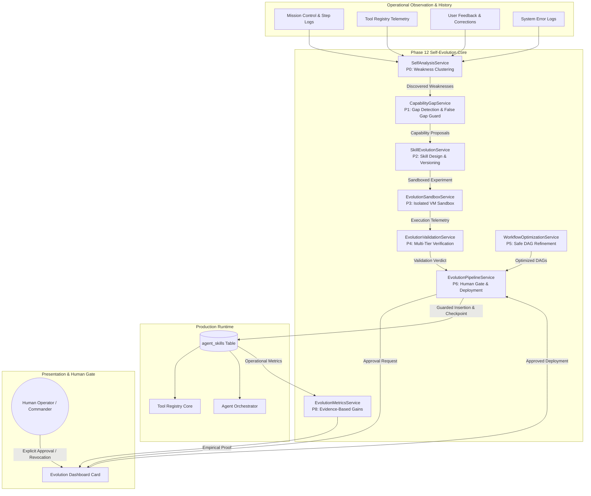

# JARVIS OS 2.0 — PHASE 12: SELF-EVOLVING INTELLIGENCE ENGINE ARCHITECTURE

## Executive Summary
Phase 12 transforms JARVIS OS 2.0 from an autonomous operating system into a **Continuously Self-Improving Intelligence System**. In contrast to unconstrained, dangerous self-modification models, JARVIS OS 2.0 adopts a strictly bounded, auditable, and human-governed evolution lifecycle:

$$\text{OBSERVE} \longrightarrow \text{ANALYSE} \longrightarrow \text{IDENTIFY} \longrightarrow \text{PROPOSE} \longrightarrow \text{GENERATE} \longrightarrow \text{SANDBOX} \longrightarrow \text{TEST} \longrightarrow \text{REVIEW} \longrightarrow \text{APPROVE} \longrightarrow \text{DEPLOY} \longrightarrow \text{VERIFY} \longrightarrow \text{ROLLBACK}$$

Production deployment is strictly gated: generated code runs exclusively in an isolated VM sandbox, cannot access production secrets or host filesystems, undergoes multi-tier validation, requires explicit human authorization, and maintains instantaneous rollback checkpoints.

---

## 1. System Topology & Architectural Layers

---

## 2. Core Service Specifications

### P0 — Self-Analysis Engine (`SelfAnalysisService`)
- **Operational Historical Analysis:** Evaluates operational history across missions, retries, and errors within configurable temporal windows ($72\text{ hours}$ default).
- **Weakness Categories:**
  - `TOOL_RELIABILITY`: Identifies tools with failure rates $\ge 25\%$ across $\ge 3$ executions.
  - `REPEATED_FAILURES`: Clusters operational faults sharing identical error signatures ($N \ge 3$).
  - `USER_REJECTIONS`: Identifies recommendation categories frequently rejected by the user.
- **Evidence & Confidence Invariant:** Distinguishes observed facts from inferred weaknesses; assigns confidence scores ($0.50$ to $0.98$) based on occurrence counts. Flukes ($N < 3$) are filtered.

### P1 — Capability Gap Detection (`CapabilityGapService`)
- **Missing Capability Detection:** Scans unhandled user intents, failed tool searches, and recurrent manual workarounds.
- **False Capability Gap Guard (Invariant 2):** Queries `ToolRegistry` and `agent_skills`. If a candidate capability is already implemented and active, the proposal is rejected immediately with `FALSE_CAPABILITY_GAP`.
- **Structured Proposal Matrix:** Formulates problem statements, operational evidence, quantifiable benefits, implementation complexity (`LOW`, `MEDIUM`, `HIGH`), security boundaries, and test requirements.

### P2 — Self-Evolving Skill Engine (`SkillEvolutionService`)
- **Skill Specification Invariant:** Every generated skill must declare:
  - `permissions`: Strict subset of authorized permission scopes (`read_file`, `write_file`, `edit_file`, etc.).
  - `dependencies`: Declared tool and API prerequisites.
  - `inputs_schema` & `outputs_schema`: JSON schema definitions.
  - `failure_conditions`: Explicit failure scenarios.
  - `implementation_code`: Sandboxed handler logic.
- **Duplicate Skill Prevention (Invariant 3):** Prevents registering duplicate skills sharing identical key and semver version.
- **Prompt Injection Defense (Invariant 22):** Scans names and descriptions for adversarial override patterns (`ignore previous instructions`, `bypass security`).
- **Malicious Code Inspection (Invariant 4):** Prohibits dangerous constructs (`process.exit`, `child_process`, `eval`, `rmdir /s /q`).

### P3 — Isolated Experimentation Environment (`EvolutionSandboxService`)
- **Filesystem Isolation (Invariant 5):** Confines execution to `nova/sandbox/experiments/<id>/`. Path escapes (e.g. `../../`) trigger `SANDBOX_FILESYSTEM_VIOLATION`.
- **Network Egress Restriction (Invariant 6):** Disables direct outbound HTTP/socket networking (`network.fetch` / `network.connect`), returning `SANDBOX_NETWORK_VIOLATION`.
- **Production Credential Isolation (Invariant 7):** Strips all production environment secrets (`GROQ_API_KEY`, `OPENROUTER_API_KEY`, `GEMINI_API_KEY`, etc.), passing only mock environment metadata.
- **Resource Exhaustion Protection (Invariant 8):** Imposes hard execution timeouts (3,000ms default) and monitors memory delta. Infinite loops are terminated immediately.
- **Automatic Cleanup:** Removes sandbox directory and temporary files post-execution.
- **Duplicate Experiment Guard (Invariant 16):** Prevents concurrent overlapping experiments for the same skill.

### P4 — Intelligent Validation Engine (`EvolutionValidationService`)
- **Multi-Tier Validation Matrix:**
  1. *Unit Testing:* Executes input/output test runs within isolated VM context.
  2. *Integration Testing:* Validates parameter binding and schema conformance.
  3. *Security Verification (Invariant 10):* Checks permission matrices against authorized boundaries.
  4. *Regression Verification (Invariant 9):* Verifies that baseline capabilities and database integrity are untouched.
  5. *Independent Output Verification (Invariant 19):* Validates return objects against schemas without trusting self-reported `{ success: true }`.
- **Verdict Decision:** Returns `ACCEPTED` only when all 5 validation tiers pass; otherwise returns `REJECTED`.

### P5 — Workflow Optimization (`WorkflowOptimizationService`)
- **Redundancy Elimination:** Detects and eliminates consecutive duplicate read operations.
- **Parallel Step Detection:** Identifies independent, non-gated steps for parallel DAG execution.
- **Safety Invariant (Invariants 17 & 18):** Optimization strictly preserves human approval gates (`requires_approval = 1`) and independent verification steps. Removing or bypassing gates triggers `INVALID_OPTIMIZATION`.

### P6 — Controlled Evolution Pipeline (`EvolutionPipelineService`)
- **Explicit Human Approval Invariant (Invariant 11):** Deployment requires explicit human authorization (`approval_status = 'APPROVED'`). Unapproved deployments throw `UNAUTHORIZED_DEPLOYMENT`.
- **Approval Revocation (Invariant 12):** Approvals can be revoked prior to deployment, invalidating the deployment pipeline.
- **Atomic Deployment & Rollback Checkpoints (Invariant 13):** Captures pre-deployment snapshots of `agent_skills`. Post-deployment anomalies trigger immediate rollback to the snapshot.
- **Corrupted Version Recovery (Invariant 14):** Schema corruptions fall back to the latest valid rollback checkpoint or safe default schema.
- **Restart Recovery (Invariant 20):** Resumes approved pending pipelines post-restart.

### P8 — Continuous Improvement (`EvolutionMetricsService`)
- **Evidence-Based Metrics Invariant (Invariant 24):** Compares pre- and post-evolution values. Claims of improvement without statistical significance ($N \ge 3$, measurable positive delta) are flagged and rejected.

---

## 3. Database Schema Architecture

Eight dedicated SQLite tables govern Phase 12 operations:
1. `evolution_weaknesses`: Empirical operational faults and confidence scores.
2. `evolution_capability_proposals`: Structured enhancement proposals.
3. `evolution_skills`: Sandboxed skill definitions, schemas, and permissions.
4. `evolution_experiments`: VM sandbox execution telemetry and resource logs.
5. `evolution_validations`: Multi-tier validation verdicts and evidence records.
6. `evolution_workflow_optimizations`: Refined mission DAGs with preserved safety barriers.
7. `evolution_deployments`: Human approvals, version diffs, and rollback checkpoints.
8. `evolution_metrics_tracking`: Pre- vs. post-evolution performance metrics.
